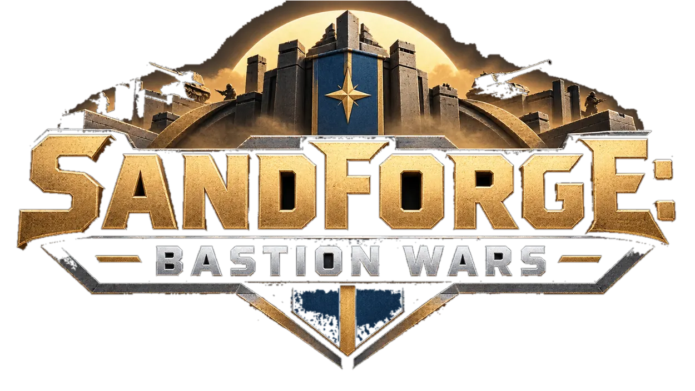

<div align="center">



# SANDFORGE: BASTION WARS

**Taktisches 3D-Wüsten-RTS · Basenbau · KI · Bastionen · Forschung · Langstreckenraketen**

</div>

> **Entwicklungsversion:** Der WebGL-Integrationslauf auf Commit [`3f30e379`](https://github.com/nfekete82/sandforge/commit/3f30e379cdf864a53fde96fce97a7d4790fdc7d6) ist am **09.11.2026 mit 17/17 Node- und 72/72 Chromium-Tests bestanden**. Die aktuelle 3D-Codebasis liegt weiter auf gestapelten Draft-PRs und ist **noch nicht in `main` integriert oder produktiv freigegeben**. Weitere Gesamt-, Classic-, Langzeit- und Deployment-Abnahmen bleiben offen. [Prüfprotokoll](docs/qa/webgl-integration-20261109-3f30e379.md).

## WebGL 3D RC2 — Standard-Spieloberfläche (Entwicklung)

Im RC2-Branch startet **Sandforge WebGL/Three.js standardmäßig unter `/`**.
Die alte Canvas-Version bleibt ausschließlich unter `/classic.html` für
Spielstands- und Regressionstests erreichbar. Am laufenden Produktionscontainer
auf Port 8095 ändert dieser Entwicklungsbranch nichts.

```sh
npm ci
npm ci --prefix tests/browser
npm run dev                    # WebGL 3D unter http://127.0.0.1:8095/
npm run test:webgl-integration # 3D Node- und Chromium-Regression
npm run test:browser           # dieselbe WebGL-Browser-Integration
npm run test:browser:classic   # explizit isolierte Legacy-Canvas-Tests
npm run dev:classic            # nur für eine separate Legacy-Arbeitskopie
```

**Separates Docker-Vorschau-Deployment, ohne Port 8095 anzufassen:**

```sh
docker compose -p sandforge-rc2-preview -f compose.rc2-preview.yaml up --build -d
# http://127.0.0.1:8106/ (3D) und /classic.html (Legacy)
docker compose -p sandforge-rc2-preview -f compose.rc2-preview.yaml down
```

Die Uberspace-Veröffentlichung ist bewusst gesperrt, bis der alte
Canvas-Paketierer vollständig auf WebGL und seine Module umgestellt und
abgenommen ist. `deploy:uberspace:check` und der bestehende Rollback bleiben
weiterhin verfügbar; **kein ungeprüfter 3D-Upload auf Uberspace**.

[RC2-Abnahme und Checkliste](docs/releases/webgl-rc2-20261106.md) ·
[WebGL-Migrationshistorie](docs/webgl-3d-release-plan.md) ·
[CI-Stresstests](https://github.com/nfekete82/sandforge/pull/236).


Lokales Wüsten-RTS mit zehn Einheitentypen, eroberbaren Bastionen und einer gegnerischen Armee aus Infanterie, Fahrzeugen und Luftunterstützung. Neue Kampagnen haben 16 Bastionen und je zwei blaue und rote Startsektoren. Alte Spielstände mit 30 Bastionen und ihren ursprünglichen Startgebieten bleiben ladbar.

Der lokale Entwicklungsstand trägt weiterhin **1.8.0**; als nächste Version ist **1.9.0** vorgeschlagen. [Release-Entwurf](docs/releases/v1.9.0-de.md), [Prüfbericht](docs/qa/release-2026-10-24.md) und [sichere Veröffentlichungsschritte](docs/releases/RELEASE.md). Die deutschen Stimmen A, B und C wurden anhand der Hörproben vom Eigentümer freigegeben und für alle 47 Meldungen aktiviert.

**Projektidentität:** Das Spiel heißt **Sandforge: Bastion Wars**, npm-Paket und Docker-Service heißen `sandforge`. Das GitHub-Repository wurde inzwischen zu `nfekete82/sandforge` umbenannt; alle bestehenden Pull Requests und die Projekt-Historie bleiben erhalten. Die Anleitung [Sandforge-Projektumbenennung](docs/SANDFORGE-RENAME.md) enthält sichere Umstellung, Befehle und Kompatibilitätsregeln. Spielstandskennungen bleiben unverändert.

## Starten

```sh
npm ci
npm run dev
```

**http://127.0.0.1:8095** — alternativ `docker compose up --build -d`. Der Server bindet standardmäßig nur an Loopback. Keine Accounts oder TTS-Anfragen während des Spielens. Start einer aktuellen WebGL-Kampagne: 950 Credits je Fraktion, ein Infanterist und ein Pionier, zunächst ohne Hauptquartier. Der Pionier errichtet zuerst das HQ; ältere Spielstände mit vorhandenen HQs bleiben im Classic-Modus erhalten. Neue Kampagnen erzeugen Gelände und erreichbare Bastionen aus einem neuen Seed; Laden stellt die gespeicherte Karte wieder her.

## Spielen

- Linksklick wählt Einheiten oder Gebäude, Ziehen markiert eine Gruppe. Doppelklick markiert sichtbare eigene Truppen.
- Rechtsklick bewegt oder greift sichtbare Gegner an. Shift hängt Befehle an. **A** aktiviert Angriffsbewegung, **S** hält die Position. Nach einem Gefecht setzen Einheiten ihren Auftrag fort.
- WASD/Pfeile und der Spielfeldrand bewegen die Kamera. Mausrad zoomt am Zeiger; Radar klicken/ziehen verschiebt den Ausschnitt. **H** zeigt das Hauptquartier, **T** die Sektorgrenzen.
- Im 3D-Spiel verbindet das untere, bildschirmbreite HUD Minikarte, Einheiten-/Gebäudekatalog, Forschung, Produktion und Befehle. Die klassische Canvas-Version nutzt weiter ihre bisherige Seitenleiste. Der Kartenrand bleibt für Befehle und Bau erreichbar.
- Jede Fraktion startet mit einem Pionier und einem Infanteriesoldaten. Das Hauptquartier bildet ausschließlich Pioniere aus. Erst eine fertiggestellte Kaserne schaltet Infanteriesoldaten, Sanitäter und schwere Infanterie frei; Fahrzeugfabrik und Flugfeld schalten Fahrzeuge beziehungsweise Luftunterstützung frei. Der Einheitenkatalog zeigt nur die durch vorhandene fertige Gebäude verfügbaren Typen. Kosten, Produktionszeit, Warteschlange und Kapazität gelten weiterhin. Ein Klick auf einen belegten Produktionsplatz storniert genau diesen Auftrag mit Kostenerstattung. Details zu Freischaltung und alten Spielständen: [Produktionsgebäude](docs/reborn-production.md).
- Pionier auswählen und im Baukatalog eine Anlage platzieren. Sie muss in erkundetem, freiem und erreichbarem Gebiet liegen; der Arbeiter muss sie tatsächlich erreichen und errichten. Rechtsklick auf eine eigene beschädigte Anlage repariert sie.
- Sanitäter heilen verletzte eigene Infanterie in 70 M Umkreis mit insgesamt 12 LP/s, auf mehrere Patienten verteilt. Ohne Beschuss regenerieren sie sich nach einer Wartezeit langsam selbst. Gruppenbefehle halten sie hinter der Front.
- Soldaten auswählen und den Transporthelikopter rechtsklicken, oder den Heli auswählen und eine eigene Infanteriegruppe rechtsklicken. Er landet zur Aufnahme von höchstens zehn Infanteristen und startet anschließend. **Ausladen** wählt einen sicheren Landeplatz; danach hebt er wieder ab. Passagiere und laufende Transportphasen werden gespeichert.
- Angrenzende Bastionen acht Sekunden im Einnahmeradius halten. Feinde unterbrechen die Einnahme. Eigene Bastionen geben 320 M Sicht; nach Verlust endet diese Sicht. Ein Rechtsklick auf Mast, Sockel oder Beschriftung führt zum Einnahmepunkt. Fluggeräte können im aktuellen Spiel ebenfalls sichern; transportierte Passagiere zählen während des Transports nicht separat.
- Felsen begrenzen Bodensicht und Schusslinien. Geschütztürme haben 600 M Reichweite und 750 M Sicht. Der Raketenwerfer reicht mit 680 M und 830 M Sicht darüber hinaus.
- Einkommen kommt alle zehn Simulationssekunden. **Leertaste** pausiert taktisch; Zahnrad oder Esc ohne Auswahl öffnet das Menü. **F5/F9** speichern/laden lokal in IndexedDB. Vor einem Neuladen speichern; bestehende Spielstände werden nicht gelöscht.
- Sieg: das gegnerische Hauptquartier zerstören und seinen Kontrollpunkt sowie alle roten Startsektoren sichern. Niederlage: keine eigene Produktionsstätte und keine eigene Truppe mehr.

| Einheit | Credits | Aufgabe |
| --- | ---: | --- |
| Infanteriesoldat | 100 | Beweglicher Schütze mit Dreiersalven |
| Sanitäter | 175 | Flächenheilung und Versorgung hinter der Front |
| Pionier | 200 | Gebäude bauen und reparieren |
| Schwere Infanterie | 250 | 420 LP, stark gegen Infanterie; weniger Schaden gegen Panzerung |
| Humvee | 350 | Schnelle Aufklärung und Flanken |
| Kampfpanzer | 550 | Gepanzerte Frontunterstützung |
| Raketenwerfer | 600 | Schwerer 6×6-Lkw mit sechs Werferrohren, fliegenden Raketen und Flächenschaden |
| Transporthelikopter | 600 | Aufklärung, zehn Passagiere und defensive Maschinengewehre |
| Bomber | 1000 | Schwere Feuerkraft gegen Bodenziele |

Der Transporthelikopter nutzt zwei eigene PBR-GLBs mit unabhängig animierten Haupt- und Heckrotoren. Reproduzierbarer Modell-/Sprite-Build: `npm run assets:transport`. Alte Kampfhelikopter und ihre bezahlten Aufträge werden beim Laden verlustfrei in Transporthelikopter migriert. [Modell, Migration und Prüfnachweise](docs/qa/transport-helicopter-20261028/README.md).

Der Raketenwerfer nutzt zwei eigene PBR-GLBs nach der HIMARS-Referenz mit Rad-, Drehkranz- und Hydraulikanimationen. Er trägt die Oliv-/Braun-/Sand-Tarnung des Panzers mit 2K-Lackdetails, Schmutzspuren und Abnutzung. `npm run assets:rocket-launcher` erzeugt Modelle und getrennte Spielsprite-Layer reproduzierbar. [Modell und Prüfnachweise](docs/qa/rocket-launcher-20261028/README.md).

Die KI bezahlt ihre Einheiten und Gebäude, sammelt gemischte Angriffsgruppen, reagiert auf gesichtete Verteidigungen, nutzt Belagerung und Flanken und zieht verletzte Truppen zur Versorgung zurück. Die KI kann Infanterie mit dem Transporthelikopter aufnehmen und am Einsatzort ausladen.

## Funk und Audio

47 lokale WAV-Meldungen bestätigen gültige Spielerbefehle. Gruppen antworten einmal; autonome KI-Befehle lösen keine Sprache aus. Master-, Effekt- und Sprachlautstärke sowie Stummschaltung stehen in den Optionen. Die Sprachwiedergabe blockiert die Simulation nicht.

Die drei fiktiven deutschen Stimmen A, B und C aus Qwen3-TTS VoiceDesign und Base sind nach Hörfreigabe für alle 47 Meldungen aktiv. Die früheren Ryan/Aiden/Serena-Aufnahmen sind gesichert. [Hörvergleich mit sieben Sätzen je Stimme und allen 47 Kandidaten](docs/audio-review/2026-10-24/index.html), [Herstellung und Lizenzprüfung](docs/audio-review/2026-10-24/README.md). ASR bestätigt die Textvollständigkeit; das Hörurteil zu den Stimmtypen stammt vom Eigentümer.

## Prüfen

```sh
npm run build
npm test                    # vollständige Node-Suite, einschließlich Archiv und HTTP
npm ci --prefix tests/browser
npm run test:browser         # WebGL-Integration: 17 Node- + 72 Chromium-Fälle (Stand 09.11.2026)
python3 scripts/audit-radio-bank.py src/assets/reborn/voices
```

Chrome ist voreingestellt; `SANDFORGE_BROWSER_CHANNEL=chromium` verwendet Playwright Chromium. `SANDFORGE_BASE_URL` prüft einen bereits laufenden Server. `SANDFORGE_TEST_DPR` steuert die Test-Pixeldichte. Die alten `ATLAS_*`-Variablen bleiben als Kompatibilitäts-Fallbacks nutzbar. Zusätzlich verfügbar: `npm run typecheck`, `npm run test:reborn`, `npm run test:animation`, `npm run assets:animation-audit` und `npm run test:ai-defense`.

[WebGL-Integration 09.11.2026: 17/17 + 72/72 PASS](docs/qa/webgl-integration-20261109-3f30e379.md) · [Älterer Release-Prüfbericht](docs/qa/release-2026-10-24.md) · [Ältere Prüfungen und Bilder](docs/reborn/QA.md) · [Änderungsprotokoll](CHANGELOG.md)

## Technik, Grafik und Quellen

TypeScript, Canvas 2D, 20 Simulationsschritte pro Sekunde, A*, räumliche Buckets und IndexedDB. Spielwerte stehen in `src/reborn/config.ts` und `src/reborn/catalog.ts`. Das Hauptspiel benötigt keine zusätzliche Laufzeitbibliothek. Three.js rendert das aktuelle WebGL-Spiel und die 3D-Galerie; die klassische Canvas-Variante bleibt separat verfügbar.

Die vier Infanterierollen teilen die freigegebene Legionär-Grundrüstung mit eigenen Details und echten Idle-/Walk-/Attack-/Hit-/Death-Clips. Sechs Fahrzeugmodelle besitzen Fraktionsmaterialien, Schatten und Rad-/Ketten-/Rotorphasen. Geschütztürme verwenden eine feste Basis und einen unabhängig drehbaren Kopf mit zwei Mündungen. Die überarbeiteten HQ- und Bastion-Quelldateien sind unter `tools/building-sources/` mit Prüfsummen dokumentiert.

[Animationslabor](http://127.0.0.1:8095/animation-lab.html) · [3D-Galerie und GLB-Downloads](http://127.0.0.1:8095/model-3d.html?model=headquarters) · [Sprite-Vergleich](http://127.0.0.1:8095/model-preview.html). Maus und Tastatur bilden die vollständige Steuerung; es gibt kein eigenes Touch- oder Mehrspielersystem.

[Asset-Änderungen des Releases](docs/releases/ASSETS-v1.9.0.md) · [Drittanbieter und Rechte](THIRD_PARTY_NOTICES.md) · [Historische Grafikquellen](docs/reborn/ART_ASSETS.md) · [Animationsquellen](tools/animation-sources/manifest.json) · [Architektur](docs/reborn/ARCHITECTURE.md). Ältere Dokumente beschreiben teilweise frühere Entwicklungsstände; maßgeblich für dieses Release sind die aktuellen Release-Unterlagen.

Die frühere Europaversion bleibt unter **http://127.0.0.1:8095/legacy/index.html** erreichbar; ihre Quellen und Dokumentation unter [legacy/README.md](legacy/README.md) bleiben erhalten.

### Performance-Debugging

Mit `/?debug&perf` lassen sich Frame-Spitzen, 1%-Low-FPS und die Kosten von Simulation, KI, Wegfindung, Rendering, Minikarte und HUD messen und als JSON exportieren. `npm run test:performance` wiederholt acht feste Lastszenarien. Messwerte, Regressionen und verbleibende Engpässe: [Performance-Bericht](docs/performance/README.md).
