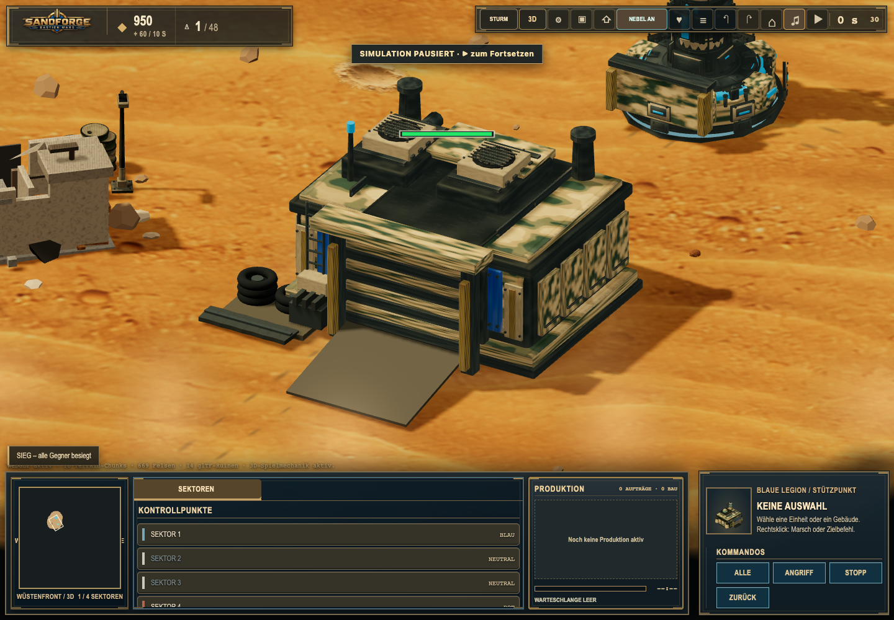
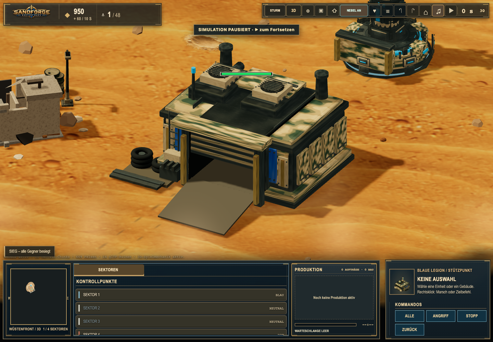
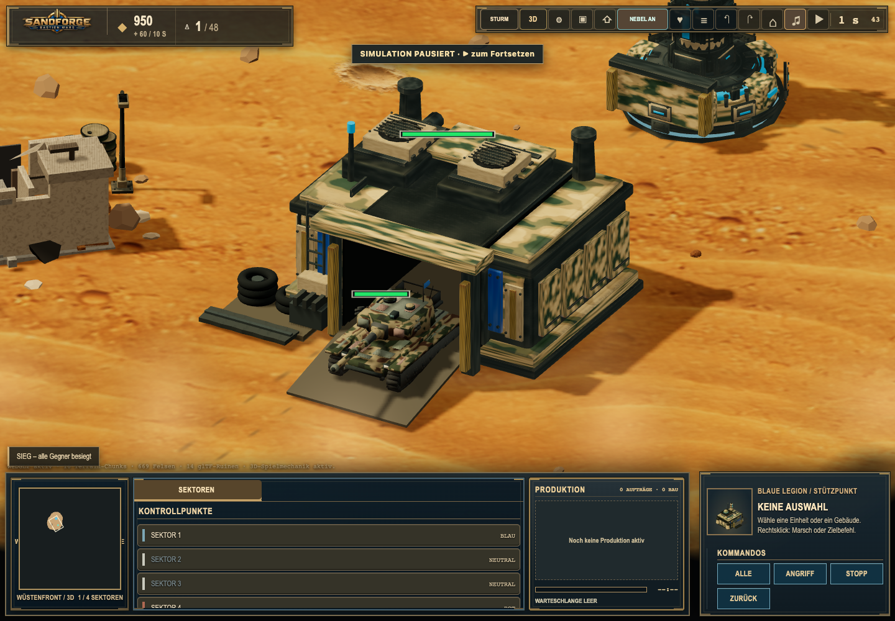

# Animated factory gates

Based on PR #240 (`5e772fa`), in the separate worktree `/private/tmp/sandforge-production-gates` and branch `feat/webgl-animated-production-gates-20261106`. This branch targets `feat/webgl-procedural-battlefields-20261106`, not main.

## Shipped behavior

Both faction factories open their actual textured shutter. A 250 ms amber warning precedes a one-second eased roll-up; the single real produced actor drives from the hall, clears the threshold, joins its authoritative interpolated position outside the footprint, and the shutter closes over one second. Tanks, Humvees and rocket artillery use their existing models and authored drive clips. Clip speed follows visual travel. Rear-facing factories receive additional departure time for the longer route around the footprint. The fixed hulls, door frame, roof and batched service surfaces have a real cut-out; there is no closed facade under the animated shutter.

The tall rocket truck needs a taller portal. The loading canopy and light strip are raised 0.15 model units; the opening is 1.52 wide and 1.21 high. Its raised roof cap is permanently batched into the existing textured roof mesh. The rest of the facade retains its original surfaces. The fixed threshold ramp is present even while the gate is closed. A dark hall, limited dust, warning lens, filtered mechanical gear sound and diesel ignition complete the presentation. Existing sound volume, mute, voice limits and pause cleanup apply.

`SandforgeProductionGates` consumes `Simulation.productionReleases`; it never spawns, moves, commands, damages, blocks or reserves simulation entities. It temporarily positions the existing actor node. Orders, colliders, rally points, population and save schema stay authoritative and unchanged. The existing simulation spawn search is independent of building orientation: after clearing the door, the visual route follows the outside of the factory footprint to the real actor position. No 180-degree turn happens inside the door.

## Assets and regeneration

Changed assets: `src/assets/reborn/buildings-3d/factory-{0,1}.{glb,json}`.

`scripts/prepare-factory-gates.py` clips individual triangles, interpolating UVs and renormalizing normals. It separates and batches existing shutter geometry by its original PBR material into `FactoryRollupDoor`. Other GLB node indices and animation targets remain intact. The three embedded 2048px PBR maps are byte-identical to PR #240; see [texture-integrity.json](texture-integrity.json). Part/triangle metadata and the GLB design metadata are regenerated. Closed shutter surfaces use two fewer draw calls than the original model; the permanent ramp uses one, for a net reduction of one draw call.

The regular CPU/GPU building exporter runs preparation after factory export. It is idempotent on an already prepared model. Regeneration needs Python 3 in addition to the existing asset tooling. Docker/runtime use the committed GLBs and do not need Python.

```sh
npm run assets:buildings -- factory
npm run assets:buildings:validate
```

## Recovery and lifecycle

- Time derives from Simulation's clock, with the same 20 Hz snapshot interpolation as normal actors. Pause freezes production animation.
- Orders changed by the player or AI, combat, damage, death, destruction, loss of visibility, blocked terrain or a neighboring actor cancel presentation. Normal synchronization immediately displays the real actor and restores the closed shutter; no duplicate actor exists.
- Missing building models, stale events, unseen production and releases received during another sequence use ordinary authoritative presentation. They never create invisible waiting units or replay old releases after streaming.
- Loading a save builds a fresh presenter; releases are deliberately absent from the save. Time rewind also clears transient presentation.
- Queue and capacity decisions remain in the existing production tick. At 100% with a blocked spawn or full capacity, no release exists and no gate animation starts.
- Independent factories own independent sequences. Repeated production reuses the prepared gate. Destruction disposes its warning material and attachments; page exit disposes all remaining gate attachments. Shared geometry/materials are reused, with no new GPU buffers per frame.

Barracks and airfields retain their existing presentation. The barracks airlock is backed by solid hull meshes; the airfield includes static display aircraft and has no prepared taxi/flight handoff. This change deliberately adds no imitation garage animation to those models. Separate asset preparation and taxi/aircraft work remains necessary for those extensions.

## Validation

Full Node regression: **1209 passed, 0 failed, 1 existing optional skip (1210 total)**. The new factory suite contains 24 passing tests. The selected existing WebGL/gameplay/stress suite plus gate acceptance: **56 passed, 2 failed**. Both failures reproduce against the unchanged PR #240 container: `webgl-perimeter-navigation` expects map version 15 instead of 19, and its camera test times out clicking the old map-settings button behind the open pause dialog. No baseline tests were weakened. The later focused factory + actor presentation run passed both tests. Docker acceptance also passes.

The new Node suite tests timing, real openings using rays against GLB triangles, PBR/UV integrity, unchanged fixed bounds, four facings, both factions, concurrent factories, repeated releases, collision cancellation, commands, combat, damage, destruction, fog, missing models, rewind, pause, render interpolation, capacity, blocked exits and save/load behavior.

The Playwright acceptance produces real units through the simulation production tick, captures all four facings for both factions, checks one real unit and unchanged rally orders, and exercises subsequent production, Humvee/artillery clearance, pause, save-schema stability and destruction. It captures browser/shader/animation errors. Snapshots advance the simulation clock deterministically while the scene remains paused.

```sh
npm test
ATLAS_BASE_URL=http://127.0.0.1:8134 ./tests/browser/node_modules/.bin/playwright test \
  --config=tests/browser/playwright.config.mjs \
  --output=/tmp/sandforge-gate-acceptance \
  tests/browser/webgl-production-gates.spec.mjs
SANDFORGE_BASELINE_URL=http://127.0.0.1:8132 \
SANDFORGE_FEATURE_URL=http://127.0.0.1:8134 node scripts/benchmark-production-gates.mjs
```

Screenshots below are from the actual GLBs in the game, not concepts or generated images.

| Closed | Half open |
| --- | --- |
|  |  |

| Open | Tank driving out |
| --- | --- |
|  |  |

Additional faction/facing and vehicle captures live beside this document.

## Performance

See [performance.json](performance.json) and `scripts/benchmark-production-gates.mjs`. The fixture contains 96 actors (48 per faction) in lite mode, measuring 600 `battlefield.sync` calls in Chrome on the same host. This is a CPU synchronization comparison and draw-call audit, not a complete GPU frame-time claim. Timer resolution is 0.1 ms.

| 96 actors | PR #240 | Gates |
| --- | ---: | ---: |
| Closed-factory mean sync | 0.0390 ms | 0.0418 ms |
| Closed-factory p95 sync | 0.1000 ms | 0.1000 ms |
| Closed-factory scene draw calls | 1510 | 1509 |
| Active gate mean sync | n/a | 0.0500 ms |
| Active gate p95 sync | n/a | 0.1000 ms |

The active fixture has one production sequence and 96 real actors. The existing combat lifecycle browser regression additionally measures actual FPS, frame p95, heap and recovery across 4/8/12/16 bastions.

## Isolated macOS preview

Docker must be running. This block creates a separate checkout, image and uniquely named container, automatically selecting a free loopback port. It does not change containers on 8095, 8116, 8128 or 8132.

```sh
set -e
SANDFORGE_CHECKOUT="$(mktemp -d "${TMPDIR:-/tmp/}sandforge-gates.XXXXXX")"
git clone --single-branch --branch feat/webgl-animated-production-gates-20261106 \
  https://github.com/nfekete82/atlas-dominion.git "$SANDFORGE_CHECKOUT"
cd "$SANDFORGE_CHECKOUT"
SANDFORGE_PREVIEW="sandforge-gates-$(date +%Y%m%d%H%M%S)"
docker build -t "$SANDFORGE_PREVIEW" .
docker run -d --name "$SANDFORGE_PREVIEW" -p 127.0.0.1::8095 "$SANDFORGE_PREVIEW"
SANDFORGE_PORT="$(docker port "$SANDFORGE_PREVIEW" 8095/tcp | awk -F: 'NR==1 {print $NF}')"
printf 'Vorschau: http://127.0.0.1:%s\n' "$SANDFORGE_PORT"
open "http://127.0.0.1:$SANDFORGE_PORT/?bastions=4&seed=2074&play=1"
```
