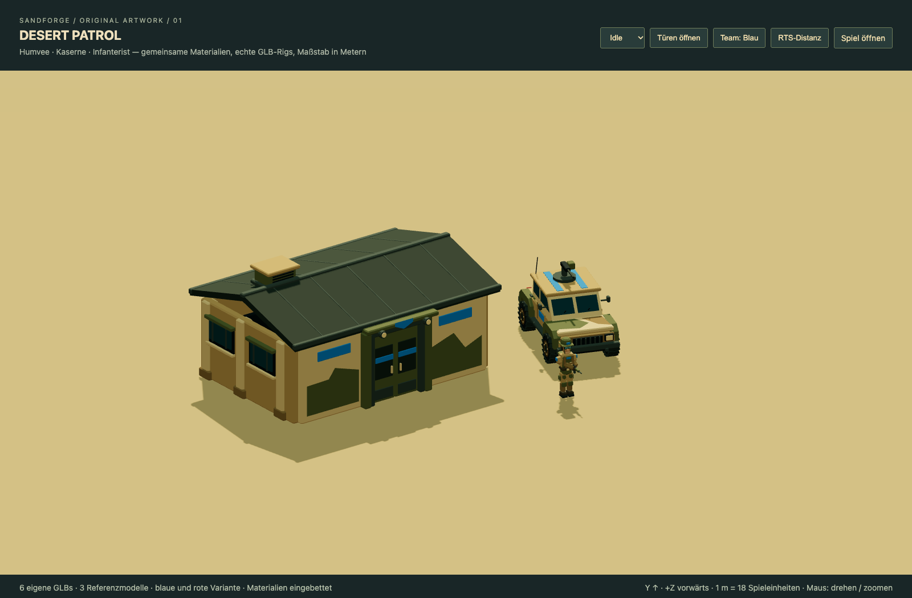

# Sandforge · Desert Patrol reference pack

Implemented 2026-11-13 on `feat/stylized-reference-pack-20261113`, based on
`feat/hq3-building-design-system-20261113` at `de365110`. This is the first
reviewable art package, **not a completed migration of the entire game**.
The existing feature branch contains substantial game work absent from `main`;
the PR therefore targets that branch to keep this change independently reviewable.



The reference pack has been approved for game integration. The full local 3D
game is available at **http://127.0.0.1:8106/** with these visuals enabled by
default. [Integration and Docker verification](INTEGRATION.md).

## Implemented assets

All geometry, colour layouts, materials and clips in `src/assets/stylized/`
are original scripted artwork. No Synty geometry, textures or other asset-pack
contents are included. Blender is unavailable on the authoring machine, so
the repository's existing Three.js GLTFExporter workflow is used. The actual
GLBs and reproducible modelling source are committed together.

| Asset / unchanged game ID | Triangles | Primitives | Approx. GLB size per team | Animation / mechanics |
| --- | ---: | ---: | ---: | --- |
| Humvee / `rover` | 6,355 | 12 | 470 KiB | Independent wheel pivots, Drive, Idle, Shoot, roof gun and muzzle |
| Kaserne / `barracks` | 5,412 | 4 | 392 KiB | Two sliding leaves, real aperture, ProductionDoor clip, construction support |
| Soldier / `infantry` | 3,620 | 1 | 435 KiB | 15-bone GLTF skin; Idle, Walk, Run, Shoot, Death; weapon muzzle bone |

Each asset has a blue and red GLB. Vertex colours (`COLOR_0`) carry the authored
paint, camouflage and dark recessed surfaces; no external textures, image
decoding, compression extension or network material dependency is required.
The soldier uses rigid segment skin weights with overlapping joints, suitable
for this angular style. It is not a smooth anatomical deformation rig or an IK rig.

## Architecture audit and integration

The shipped default is WebGL (`scripts/build.mjs`), with an authoritative
TypeScript `Simulation`, an orthographic camera, local Three.js 0.180.0,
GLTFLoader and SkeletonUtils clones. `webgl-battlefield.js` adapts simulation
entities to presentation nodes. Existing movement, AI, HUD, fog, resources,
construction costs, IDs, balance and save formats remain in their existing code.
The classic Canvas renderer and sprite atlases are retained.

The previous reference assets were selected from `reborn/animation/`,
`reborn/prototype/` and the strategic building GLB table. They used independent
height/width normalization, a barracks-specific Y stretch and a door-ground
offset of 1.37 source units. Applying these import corrections to the new
metre-based assets would shrink the soldier and distort the building. The
new metadata opts only these three models into one shared scale and an
authored ground pivot; all other assets retain their prior calibration.

Relevant existing gameplay dimensions: infantry width 38, radius 11; rover
width 76, radius 18; barracks width 158, radius 53. Navigation also uses its
existing larger building avoidance circles. The new barracks' ground geometry
is tested against that existing infantry clearance. No collision radius or
production rule is changed. Its entrance clears the 2.07 m soldier by over 15%.

The existing production presenter opens the real leaves before revealing the
single authoritative soldier, walks it along the authored ground-level lane
through local -Z, and then routes it around the building toward the original
simulation spawn/rally position. The same lane rotates with all four facings.
The existing triangle-height construction system now supports either the old
closed variant or a single new model. Vehicles animate from measured travel,
so an unfulfilled move order cannot rotate stationary wheels. Infantry uses
the Run clip during normal movement and the existing 0.12 s animation crossfade;
Walk remains available for inspection. Death plays on the retained real model.
Muzzle flashes follow the exported weapon attachment.

Both original asset paths and the original GLBs are preserved. A failed new
GLB request loads the previous authored model. `?art=legacy` explicitly selects
the old visuals for comparison. Capturing a new barracks repaints only its team
colours with an actor-owned material, leaving cached meshes and other instances intact.

## Art and export rules

- Metres; Y up; +Z forward for units; barracks entrance -Z. Root at ground,
  X centred; pivot and lane do not depend on decorative bounds.
- Exactly 18 game units per metre for the three references. No nonuniform
  scale, baked root-motion travel or re-centering after import.
- Palette lives in `scripts/art/stylized-kit.mjs`: sand `#bd985b`, light sand
  `#dfbd80`, olive `#666c40`, charcoal roof `#303e35`, recess `#192a2b`,
  blue `#278ac7`, red `#c94c38`. Large intentional colour facets; no fine noise.
- Common chamfered polygon volumes, extruded profiles, aperture proportions,
  window mullions, vent slats and equipment bevels. Tyres have shaped sidewalls
  and separate chevron tread; wheel rotation pivots sit at axle centres.
- PBR paint roughness .83 / metalness .08; steel .56 / .48; opaque glazing
  .26 / .24. Existing world lighting, tone mapping and shadow pipeline are reused.
  Dark authored cavities and contact shadows provide depth; no baked AO texture
  or new screen-space AO pass is included in this package.
- Merge static components by rigid parent and coating; weld identical vertices;
  keep movable nodes separate. All triangles have nonzero area and unit normals.
- Export GLB 2.0 with embedded buffer, vertex colour, materials, skin and named
  clips. Maximum per reference: 7,000 triangles, 13 primitives, 550,000 bytes.
  SHA-256, bounds, triangle counts and clip names are in `manifest.json`.

## Reproduction and review

```sh
npm ci
npm run assets:stylized
npm run assets:stylized:check
npm run test:stylized
npm run test:building-design
npm run preview
```

Open `/art-gallery.html` for the three models under identical lighting,
team switching, animation selection, doors and RTS-distance comparison.
Start a local preview, then run the browser QA with its actual port:

```sh
SANDFORGE_BASE_URL=http://127.0.0.1:8095 npm run test:stylized:browser
```

The browser runner uses the already established Playwright installation at
`tests/browser/node_modules` and the installed Chrome browser. It writes the
reference views, detail views, animation poses, open doorway and real-game
screenshot alongside structured runtime results in `qa/`.

Executed checks and their exact scope are recorded in [QA.md](QA.md).

## Explicitly open

Feldkommando, factory/reparation yard, research, airfield, silo, bastions,
tanks, rocket trucks, aircraft, infantry specialists, walls, turrets, ruins
and terrain objects retain their existing artwork. Existing yards, prop
decorations, HUD thumbnails and portraits are also not converted. The game
therefore still mixes the new reference style with legacy assets.

Before expanding the pack: review these real screenshots and silhouettes,
extend authored role variations and weapon grips, inspect gait/contact across
all frames and slopes, add appropriate LODs/instancing for very large armies,
and re-check the existing facility collision envelopes per model. No claim is
made that a full commercially finished army/environment pack is delivered here.
